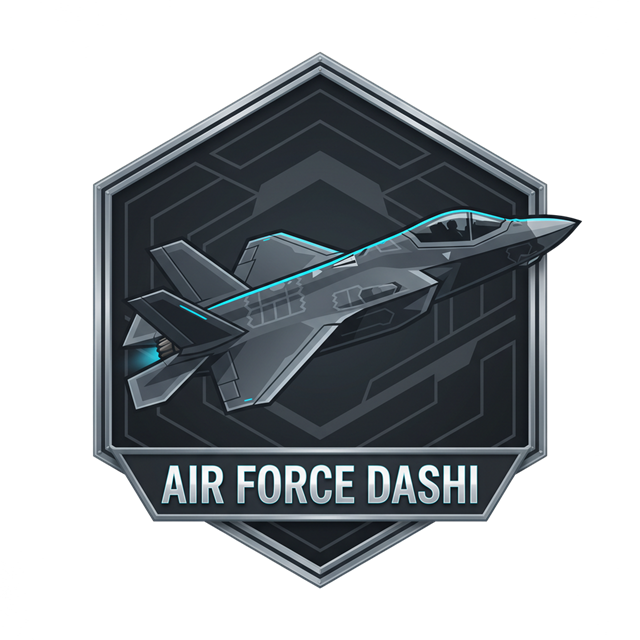
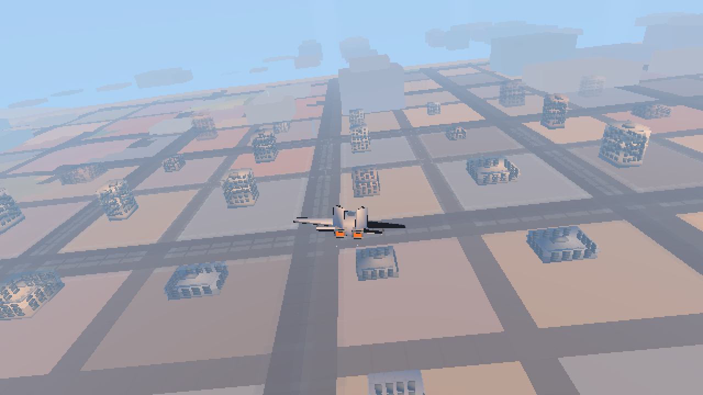
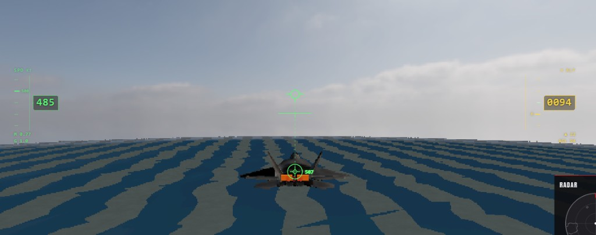
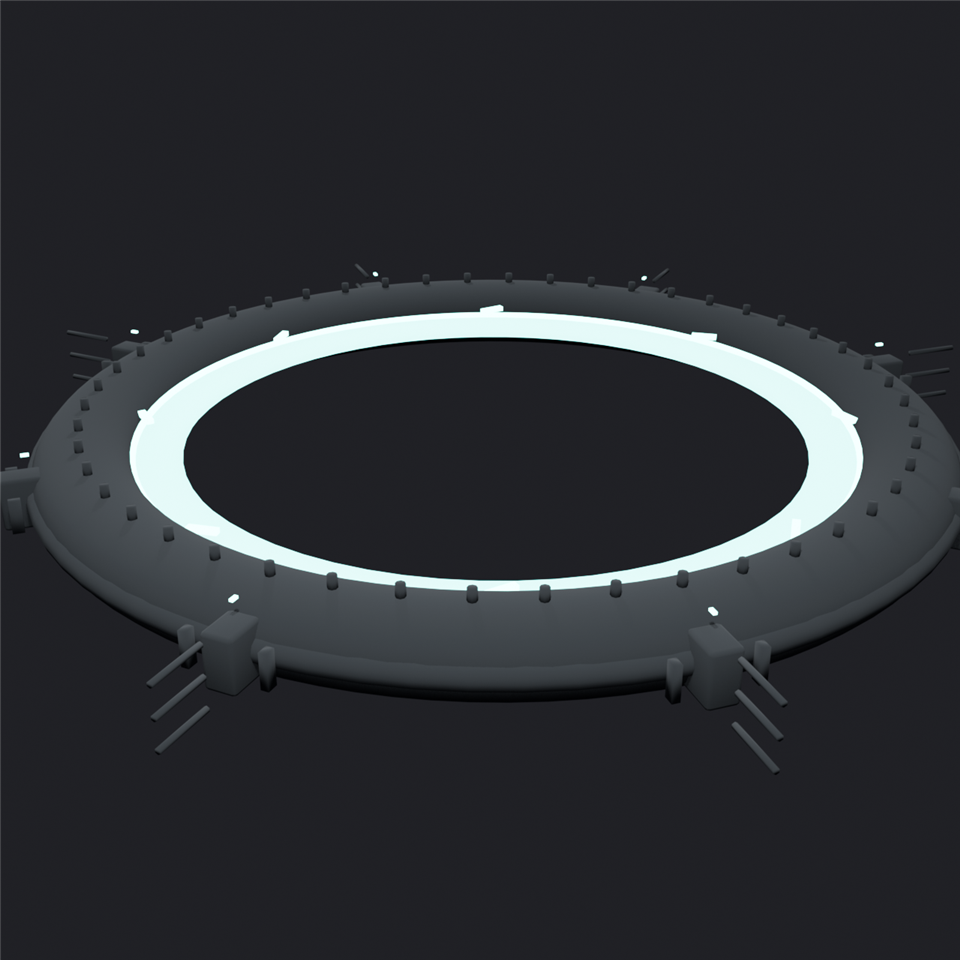
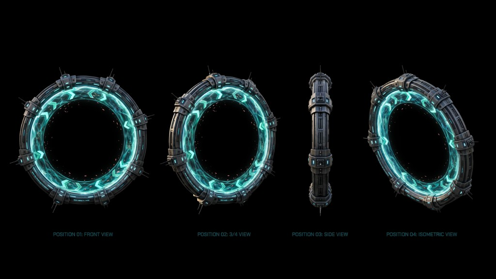
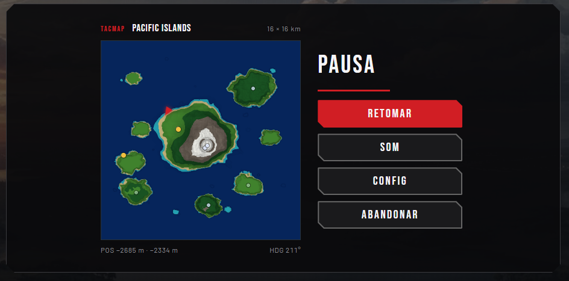
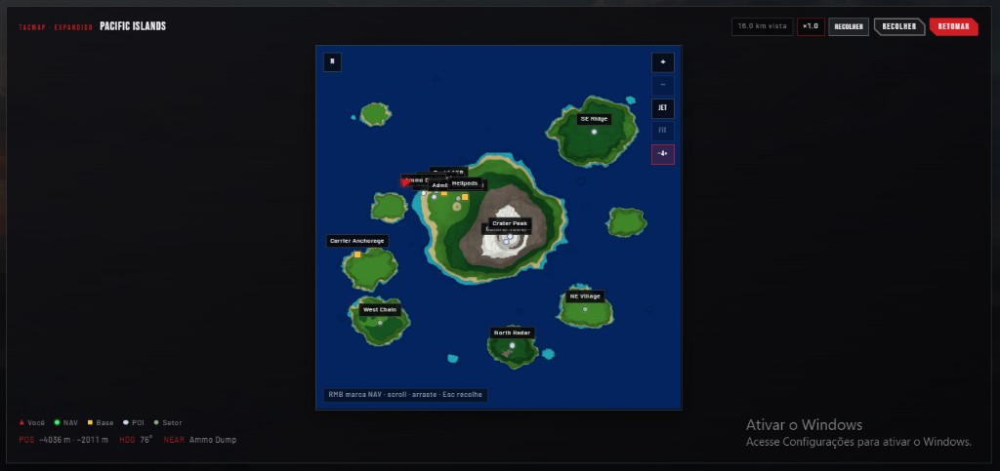
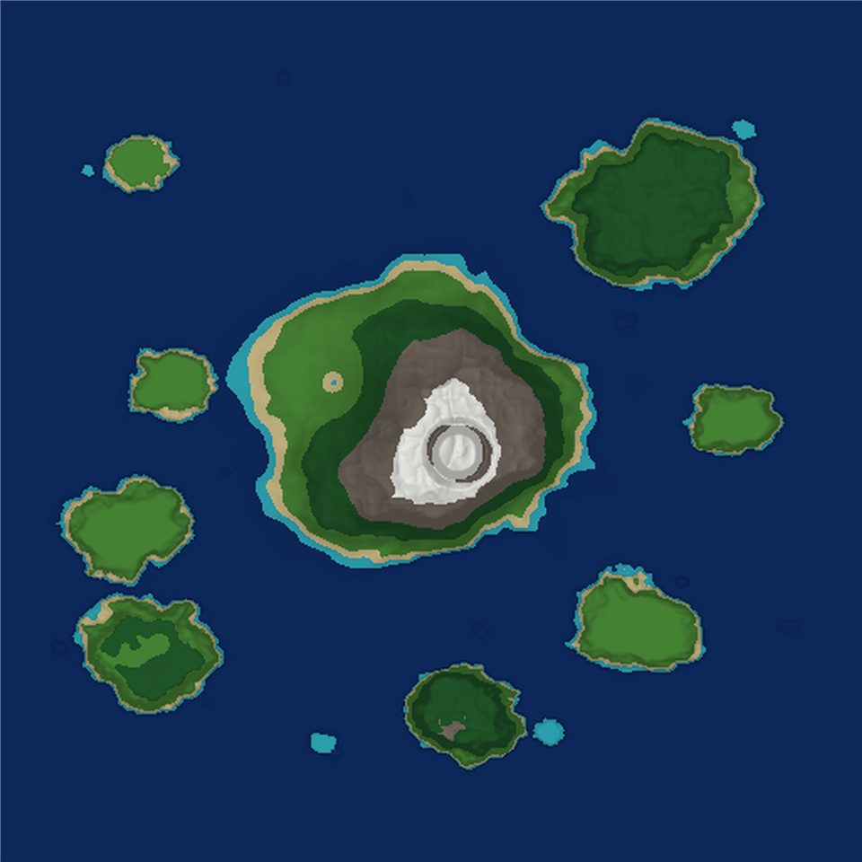

# Air Force Dashi

<p align="center">
  
</p>

<p align="center">
  <strong>Arcade de voo no navegador</strong> — frota multi-jet,<br/>
  mapa Pacific Islands, hubs de produto e missões curtas.
</p>

<p align="center">
  
</p>

<p align="center">
  <a href="#stack"></a>
  <a href="#stack"></a>
  <a href="#como-rodar"></a>
  <a href="#configurações"></a>
  <a href="#licença"></a>
</p>

---

## Sobre

**Air Force Dashi** é um *flying toy* arcade com casca de produto web: sessões curtas no browser, sensação de voo caprichada e meta-game (Credits, Hangar, Operações, Loja).

O cliente de produção é **Vite + React + Three.js**. A API **Hono** valida economia; **Supabase** persiste progresso quando configurado.

### Destaques

- **Hubs de produto** no visual `reestilo` (menu, pré-partida, hangar, carreira, loja, perfil, config, lobby)
- **Modos:** CheckPoint, Anti-Drone, Attack, Tiro ao alvo e Vôo Livre
- **Frota** com loadout AA/AG, skins, emblemas e preview 3D no Hangar
- Mapa **Pacific Islands** (16×16 km) com tacmap, NAV e PDIs
- Mundo com heightmap, vegetação, água ciano, céu/nuvens e horizonte radial
- Portões de CheckPoint metálicos com anel neon (ciano → vermelho)
- HUD estilo F-22 (tapes, radar, lock A/A·A/G) + pause com tacmap
- Mísseis com VFX (Quarks), explosões escalonadas por qualidade
- Áudio de cockpit + SFX/theme de UI
- Economia **sem pay-to-win** — Credits por jogar; cosméticos premium separados
- Qualidade gráfica **Low / Med / High / Ultra** (resolução interna + densidade de FX)

---

## Capturas

### Vôo Livre

Chase cam sobre relevo e horizonte aberto.



### Oceano

Baixa altitude sobre o mar (textura ciano, disco sem borda quadrada).



### CheckPoint

Anel / portão neon do curso aéreo.


<p align="center">
  
  &nbsp;
  
</p>

### Pause · Tacmap

Pause com TACMAP Pacific Islands e menu Retomar / Config.



### Tacmap expandido

Vista 16 km com legendas, zoom e marcações NAV / Base / PDI.



### Mapa Pacific Islands

Preview top-down do arquipélago.



### Title art

Arte pixel do F-22 (bandeira de São Paulo na fuselagem).


---

## Modos de jogo

| Modo | O que é |
|------|---------|
| **CheckPoint** | Curso de anéis/portões no ar; níveis desbloqueáveis; progresso local (+ sync API). |
| **Anti-Drone** | Caça a alvos aéreos com locks e burst. |
| **Attack** | Alvos no solo / destruição com colapso local. |
| **Tiro ao alvo** | Prática com alvos e políticas de lock por nível. |
| **Vôo Livre** | Explore sem missão — ilhas, oceano, bases. |

Fluxo típico: **Main Menu → Pré-partida → Gameplay → Resultado**.

---

## Controles (cliente web)

| Input | Ação |
|-------|------|
| **W / S** · ↑ / ↓ | Subir / descer (pitch) |
| **A / D** · ← / → | Bank + curva |
| **LMB** ou **V** | Disparar |
| **RMB** ou **Shift** | Afterburner (segurar) |
| **F** | Barrel roll |
| **Space** | Ciclar câmera (top → chase → rear → cockpit → free) |
| **C** | Olhar para trás (segurar) |
| **Q** | Inspeção (fora do FREE) / descer no FREE |
| **E** · **PageUp** | Subir na câmera FREE |
| **PageDown** | Descer na câmera FREE |
| Mouse | Look / trim |
| **Esc** | Pause |
| **M** | Ligar/desligar som |

No hub, o primeiro clique em qualquer controle **arma** o theme + SFX de UI (botão ♪ no topo).

---

## Configurações

| Opção | Valores |
|-------|---------|
| **Qualidade** | `low` · `medium` · `high` · **`ultra`** |
| Áudio | Master / SFX |
| Sensibilidade | Mouse |

**Ultra** sobe a resolução interna (~720 px de altura) e a densidade de explosões/partículas/luzes. Aplica no **próximo voo**.

---

## Stack

| Camada | Tecnologia |
|--------|------------|
| Cliente | Vite 6 · React 19 · Three.js · TypeScript |
| Simulação | `@afd/game-core` (sem WebGL) |
| Render | `@afd/game-render` (cena de voo, preview do hangar, FX) |
| Economia | `@afd/economy` + DTOs em `@afd/shared-types` |
| API | Hono em `apps/api` (`http://localhost:8787`) |
| Persistência | Supabase (opcional; service role só no server) |
| Ensaio visual | `reestilo/` (HTML/CSS/JS + áudio de referência) |

Roteiro da migração e budgets: [`docs/migracao-threejs-v1.md`](docs/migracao-threejs-v1.md).

---

## Como rodar

Requisitos: **Node ≥ 20**, Windows/macOS/Linux, browser moderno (Chrome recomendado).

```bash
git clone https://github.com/DashiGabriell/AirForceDashi.git
cd AirForceDashi
npm install
```

### Variáveis de ambiente

Copie o exemplo e preencha as chaves (nunca exponha `SERVICE_ROLE` no Vite):

```bash
cp .env.example .env
```

| Variável | Onde | Uso |
|----------|------|-----|
| `VITE_SUPABASE_URL` | cliente | URL do projeto |
| `VITE_SUPABASE_PUBLISHABLE_KEY` | cliente | anon / publishable |
| `SUPABASE_URL` | API | URL do projeto |
| `SUPABASE_SERVICE_ROLE_KEY` | API | persistência server-side |
| `SUPABASE_TOKEN` | tools | bootstrap Management API (opcional) |

Sem Supabase, o jogo roda com **progresso local**; a API continua servindo economia in-memory.

### Scripts

```bash
npm run api      # Hono · http://localhost:8787
npm run dev      # Vite · http://localhost:5173 (proxy → api)
npm run build
npm run preview
npm run typecheck
npm run test
npm run budget   # gate de tamanho do JS em apps/web/dist
```

Suba **api** e **dev** em paralelo para wallet, grants e sync.

### Deploy (Vercel · single-player)

Um projeto Vercel no root do monorepo:

1. Importar o repo no [Vercel](https://vercel.com) (Root Directory = `.`).
2. Env (Production + Preview): `SUPABASE_URL`, `SUPABASE_SERVICE_ROLE_KEY`, opcional `CORS_ORIGIN` (domínio custom).
3. Build: `npm run build:vercel` → static em `apps/web/dist` + function `api/[[...route]].js`.
4. No browser, a economy fica em **mesmo domínio** `/api/*` (sem CORS extra).

Persistência real exige Supabase na API (senão a economy fica só em memória por instância serverless). Multiplayer ao vivo fica para uma VPS depois.

### Supabase

Schema versionado em [`supabase/migrations/`](supabase/migrations/) (`public.afd_*`). Ver [`supabase/README.md`](supabase/README.md).

```bash
npx supabase link --project-ref pkcupqxmeftiakpzdxls
npx supabase db push
# ou sem CLI:
node tools/apply-afd-migration.mjs
node tools/smoke-supabase-persist.mjs
```

### Tools úteis

```bash
node tools/bootstrap-supabase-env.mjs
node tools/apply-afd-migration.mjs
node tools/smoke-supabase-persist.mjs
node tools/measure-bundle.mjs
```

---

## Estrutura do repositório

```
AirForceDashi/
├── apps/
│   ├── web/                 # Cliente Vite + React + Three
│   └── api/                 # Hono — wallet / grants / loja / persist
├── packages/
│   ├── game-core/           # Simulação, missões, progresso, frota
│   ├── game-render/         # Cena de voo, hangar preview, FX
│   ├── economy/             # Schemas + service
│   └── shared-types/        # Enums / DTOs / budgets
├── supabase/                # config.toml + migrations (public.afd_*)
├── reestilo/                # Ensaio visual + áudio de UI
├── assets/                  # Mapas, modelos 3D, refs de arte
├── tools/                   # Bundle, apply migrate, clouds, harness
├── docs/                    # Economia, telas, migração, VFX…
└── docs/images/             # Arte e capturas do README
```

---

## Hubs e produto

| Hub | Papel |
|-----|--------|
| **Main Menu** | Identidade + CTA Jogar / Vôo Livre |
| **Pré-partida** | Modo → aeronave → Play |
| **Gameplay** + **Pause** | Voo, HUD, tacmap, objetivos |
| **Resultado** | Score, Credits, XP, replay |
| **Hangar** | Frota, skins, emblemas, efeitos, mastery, loadout |
| **Carreira / Operações** | Dailies, weeklies, XP / patente |
| **Loja** | Catálogo Credits (+ premium depois) |
| **Perfil** | Callsign, medals, stats |
| **Configurações** | Áudio, gráficos (incl. Ultra), sensibilidade |
| **Lobby** | Stub TvT / matchmaking |

Detalhes de UX: [`docs/telas-produto-v1.md`](docs/telas-produto-v1.md).  
Moedas e anti-P2W: [`docs/economia-v1.md`](docs/economia-v1.md).

---

## Documentação

| Doc | Domínio |
|-----|---------|
| [`docs/migracao-threejs-v1.md`](docs/migracao-threejs-v1.md) | Engine web, performance, fases |
| [`docs/telas-produto-v1.md`](docs/telas-produto-v1.md) | Hubs e fluxos |
| [`docs/economia-v1.md`](docs/economia-v1.md) | Credits, XP, loja, fases de backend |
| [`docs/decisao-vfx-misseis-v1.md`](docs/decisao-vfx-misseis-v1.md) | Motor VFX de mísseis / explosões |
| [`docs/destruicao-predios-v1.md`](docs/destruicao-predios-v1.md) | Colapso local (Attack) |
| [`docs/cidade-cityjson-atlas-v1.md`](docs/cidade-cityjson-atlas-v1.md) | CityJSON → atlas de prédios |
| [`docs/frota-glb-bake-todo-v1.md`](docs/frota-glb-bake-todo-v1.md) | Bake GLB por aeronave |

---

## Créditos

- Projeto: **DashiGabriell**
- Cliente web: Three.js · React · Vite · Hono · Supabase
- Fontes de produto: ensaio `reestilo` (tipografia e tokens do hub)

---

## Licença

Distribuído sob os termos da licença **MIT**. Veja [LICENSE](LICENSE).
