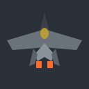
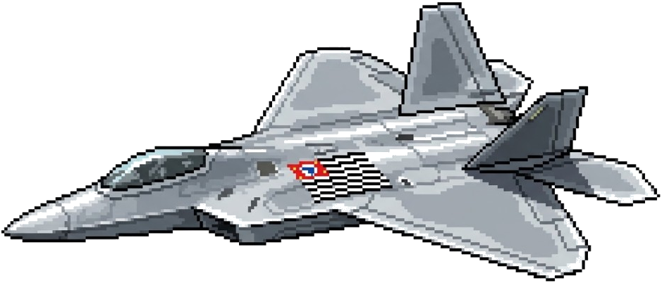
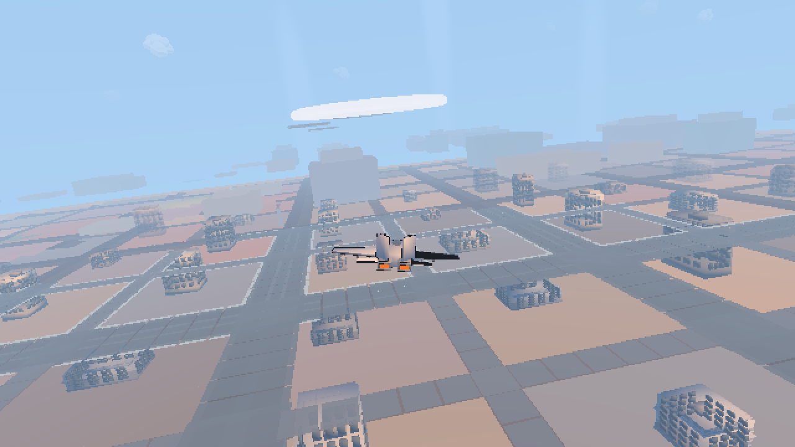

# Air Force Dashi

<p align="center">
  
</p>

<p align="center">
  <strong>Brinquedo de voo com F-22</strong> — país de lagos no fim da tarde,<br/>
  mundo procedural, missões CheckPoint e Vôo Livre.
</p>

<p align="center">
  
</p>

<p align="center">
  <a href="#modos-de-jogo"></a>
  <a href="#como-jogar"></a>
  <a href="#licença"></a>
</p>

---

## Capturas

### Vôo Livre

Explore o mapa procedural em câmera chase, com cidade, névoa e horizonte aberto.


### CheckPoint

Trinta níveis progressivos de anéis no ar — gates, tempo e rota cada vez mais exigentes.



### Title art

Arte pixel do F-22 (com detalhe da bandeira de São Paulo na fuselagem) usada na tela inicial.


---

## Sobre

**Air Force Dashi** é um *flying toy* arcade feito em **Godot 4.7** (Forward Plus) para desktop Windows. O foco é sensação de voo, leitura pixel e um mundo vivo — não um simulador militar pesado.

### Destaques

- **Dois modos** na tela inicial: **CheckPoint** e **Vôo Livre**
- Mundo **10×** com heightmap procedural, biomas, ruas, skyline com LOD e fade
- Voo arcade **WASD** + mouse como trim leve
- HUD estilo F-22 (CCIP, tapes, avisos) e cockpits
- Mísseis com traçante, explosões em estágios e colisão em prédios
- Ciclo dia/noite (~12+12 min), névoa matinal, nuvens densas à tarde, chuva leve ocasional
- Tráfego aéreo distante (silhuetas) e áudio sintético / amostrado
- Paleta de menus: **preto · vermelho · branco · cinza** (Bebas Neue + Barlow)

---

## Modos de jogo

| Modo | O que é |
|------|---------|
| **CheckPoint** | 30 níveis progressivos de anéis no ar. Progresso salvo localmente. |
| **Vôo Livre** | Explore o cenário sem missão — lagos, cidades, aeroportos. |

**CheckPoint — atalhos**

| Tecla | Ação |
|-------|------|
| **R** | Reiniciar o nível |
| **N** | Próximo nível (após clear) |

---

## Controles

| Input | Ação |
|-------|------|
| **W / S** | Subir / descer |
| **A / D** | Bank + curva |
| **LMB** | Disparar míssil |
| **RMB** | Afterburner (segurar) |
| **F** | Barrel roll |
| Mouse | Trim leve (com WASD solto) |
| **Space** | Ciclar câmera (top → chase → cockpit → free) |
| **Esc** | Pause (som + sensibilidade do mouse) |
| **M** | Ligar/desligar som |

---

## Como jogar

### Godot (referência de feel)

- [Godot 4.7+](https://godotengine.org/download) (Forward Plus)
- Windows 10/11

1. Clone o repositório
2. Abra a pasta no Godot 4.7+
3. Rode a cena principal `scenes/main.tscn` (**F5**)

```bash
git clone https://github.com/DashiGabriell/AirForceDashi.git
cd AirForceDashi
godot --path .
```

No Windows também há `run.bat`, se preferir.

### Cliente web (Three.js — migração em curso)

Node **≥ 20**. Fase atual: **M8** (DC stub · Battle Pass · Lobby TvT).

```bash
npm install
npm run api      # economia Hono · http://localhost:8787
npm run dev      # http://localhost:5173 (proxy → api)
npm run build
npm run test
npm run budget   # gate de tamanho do JS em apps/web/dist
```

Roteiro e budgets: [`docs/migracao-threejs-v1.md`](docs/migracao-threejs-v1.md).

---

## Estrutura do projeto

```
AirForceDashi/
├── scenes/ scripts/ shaders/ …   # Godot — referência viva
├── apps/web/                     # Vite + React + Three.js
├── apps/api/                     # Hono — wallet / grants / loja
├── packages/
│   ├── game-core/                # simulação TS (sem WebGL)
│   ├── game-render/              # Three.js
│   ├── economy/                  # schemas + service in-memory
│   └── shared-types/             # DTOs / enums / budgets
├── tools/                        # measure-bundle, harness
├── docs/                         # economia, telas, migração
├── assets/ui/ fonts/
└── docs/images/
```

---

## Desenvolvimento

Validação headless útil:

```bash
godot --headless --path . -s res://scripts/validate.gd
godot --headless --path . -s res://scripts/validate_checkpoint.gd
```

Captura de screenshots para docs (abre janela breve):

```bash
godot --path . -s res://scripts/capture_readme.gd
```

Progresso de CheckPoint e opções ficam em `user://airforce_dashi.cfg`.

---

## Créditos

- Projeto: **DashiGabriell**
- Engine: [Godot](https://godotengine.org/)
- Fontes: [Bebas Neue](https://fonts.google.com/specimen/Bebas+Neue), [Barlow](https://fonts.google.com/specimen/Barlow) (OFL)

---

## Licença

Distribuído sob os termos da licença **MIT**. Veja [LICENSE](LICENSE).
